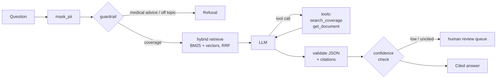

# CoverWise

A Medicare coverage Q&A agent. You ask *"Does Medicare cover hearing aids?"* and get a short answer **built only from official Medicare.gov coverage pages, with citations**. Personal data is masked before it goes anywhere, medical-advice questions are refused, and uncertain answers are sent to a human review queue.

> Not medical or legal advice. An educational project using public Medicare.gov content.

**Stack:** Python · FastAPI · LangGraph · ChromaDB · fastembed (BGE-small embeddings) · BM25 · Pydantic · Prometheus · Docker · Kubernetes · GitHub Actions · Google Cloud Run · .NET 8 + Semantic Kernel

## Architecture



| Node | What it does |
|---|---|
| `mask_pii` | Regex masking of email, phone, SSN, Medicare ID, dates and member IDs. Raw text never reaches the LLM or logs. |
| `guardrail` | Classifies the question as coverage, medical advice or off topic. Refusals skip retrieval and the LLM entirely. |
| `retrieve` | Hybrid search: BM25 plus cosine search in ChromaDB, combined with Reciprocal Rank Fusion. |
| `llm` ⇄ `tools` | LLM tool calling (`search_coverage`, `get_document`), up to 3 rounds. |
| `validate` | Pydantic-validates `{"answer", "citations"}` with one repair retry, and drops any citation that wasn't retrieved. |
| `confidence_check` | Below the similarity threshold, or with no valid citation, the answer is flagged `needs_review` and queued for a human. |

## Evaluation

`eval/golden.jsonl` has 30 hand-written questions: 20 coverage questions (mostly paraphrased, e.g. *"cloudy eye lens"* for cataracts), 5 medical-advice and 5 off-topic. Results from `python eval/run_eval.py` on 26 documents / 84 chunks:

| Retrieval (20 coverage Qs) | recall@1 | recall@5 | MRR |
|---|---|---|---|
| BM25 only | 0.90 | 0.90 | 0.90 |
| Vector only | **0.95** | **1.00** | **0.967** |
| Hybrid (RRF) | 0.90 | **1.00** | 0.927 |

| Guardrails (30 Qs) | |
|---|---|
| Intent accuracy | 1.00 |

**What this shows:** on paraphrased questions, embeddings beat keywords, and hybrid search keeps recall@5 at 1.0. Vector-only is slightly better at rank 1 on this set. Hybrid stays the default because BM25 protects exact-term queries (procedure names, plan parts) that embeddings can miss. CI **fails the build** if hybrid recall@5 drops below 0.90 or intent accuracy below 0.90.

**End-to-end agent with a live LLM** (`python eval/run_eval.py --with-llm --pause 5`, Gemini `gemini-flash-lite-latest`, 20 coverage Qs):

| Metric | Value |
|---|---|
| Answers with at least one valid citation | 1.00 |
| Answers citing the expected Medicare.gov page | 1.00 |
| Sent to human review | 0.00 |
| Latency p50 / p95 | 1.9 s / 10.1 s |

The p95 tail comes from questions where the model made extra tool calls before answering.

**Limits:** the golden set is small and written by the author, and the guardrail is rule-based, so 1.00 is likely optimistic on real traffic. A 0% review rate on 20 in-scope questions also means the confidence threshold hasn't been tested against hard out-of-corpus questions yet.

**Provider notes:** Gemini 3 models reject a tool-result turn unless the tool call's `thought_signature` is echoed back, so the client preserves provider `extra_content` on tool calls. Free-tier daily quotas are small (20 requests/day/model on some models), so the eval paces requests and retries on 429/503, timing only the successful attempt.

## Responsible AI

- **Privacy:** PII is masked before retrieval, LLM calls and logging. Logs hold only masked text and metadata.
- **Grounding:** answers must cite retrieved chunks. Made-up citations are removed, and an answer left uncited goes to human review.
- **Scope:** medical advice and off-topic requests are refused without calling the LLM.
- **Human in the loop:** low-confidence answers are queued at `GET /review-queue`.
- **Failure honesty:** if the LLM is unavailable the API returns `503`. It never serves canned answers.

## Monitoring

`GET /metrics` (Prometheus): requests by intent, needs-review count, LLM errors, PII masked by type, tokens, estimated cost, latency histogram, and a **retrieval-confidence histogram**. A falling confidence distribution is an early sign of drift: users asking about topics the corpus doesn't cover. Every request also writes one JSON log line with latency, tokens, cost and confidence.

## Run locally

```bash
python -m venv .venv && .venv/Scripts/activate        # Linux/macOS: source .venv/bin/activate
pip install -e ".[dev]"
python scripts/fetch_data.py        # optional: refresh data/raw from Medicare.gov
python -m coverwise.ingest          # build ChromaDB + BM25 indexes
export LLM_API_KEY=<free Gemini API key>   # optional; refusals work without it
uvicorn coverwise.api:app --port 8080      # open http://localhost:8080/docs
pytest -q && python eval/run_eval.py
```

Any OpenAI-compatible model works: set `LLM_BASE_URL`, `LLM_MODEL` and `LLM_API_KEY`.

## Deploy

- **Docker:** `docker build -t coverwise . && docker run -p 8080:8080 -e LLM_API_KEY=... coverwise`. The index and embedding model are baked into the image.
- **Kubernetes:** `k8s/coverwise.yaml` defines a Deployment (2 replicas, readiness/liveness probes, non-root), a Service and a HorizontalPodAutoscaler. CI deploys it to a **kind** cluster and smoke-tests it.
- **Google Cloud Run:** `.github/workflows/deploy-cloudrun.yml` builds, pushes to Artifact Registry and deploys after CI passes on `main`, with the LLM key from **Secret Manager**. Setup: set repo variables `GCP_PROJECT_ID`, `GCP_REGION` and secret `GCP_SA_KEY`, and create the `coverwise` Artifact Registry repo and `coverwise-llm-key` secret.

## .NET integration (Semantic Kernel)

`clients/dotnet/CoverWise.SkClient` shows how a .NET enterprise app can use CoverWise: the service is registered as a **Semantic Kernel plugin** (`ask_coverage_question`). With `OPENAI_API_KEY` set, an LLM decides when to call it (auto function calling). Without one, the kernel invokes it directly. CI runs it against the live container.

```bash
cd clients/dotnet/CoverWise.SkClient && dotnet run -- "Does Medicare cover hearing aids?"
```

## CI/CD

`ci.yml`: ruff → pytest (27 tests, fake LLM) → build index → **eval gate** → Docker build and smoke test → .NET Semantic Kernel client → kind Kubernetes deploy and smoke test. `deploy-cloudrun.yml` then deploys to Cloud Run.
